<p align="center"></p>

# FraudLens

**Enterprise financial fraud detection and investigation platform for organizations that work with their own transaction data.**

FraudLens turns raw transaction files into prioritised, explained alerts and gives fraud teams a structured place to
investigate them. It is designed as a multi-organization (B2B) product, with a complete English and French interface.

> This repository presents the product. The source code is proprietary and is not published — see [LICENSE](LICENSE).

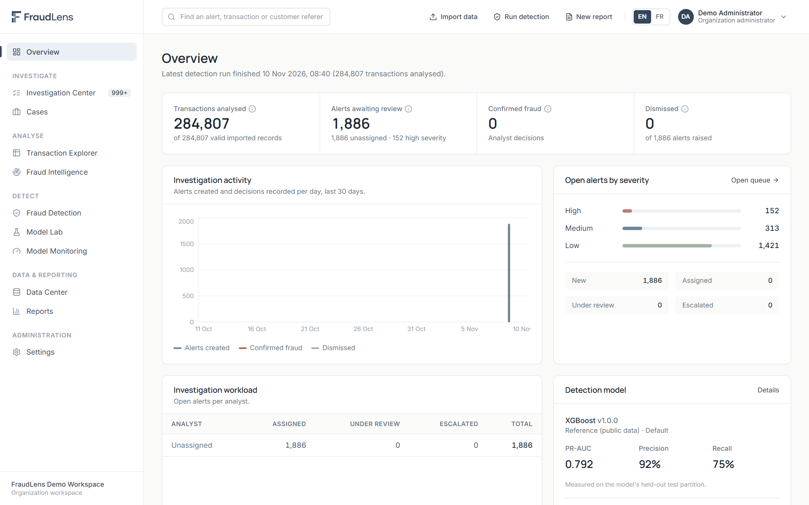

## Contents

- [The problem](#the-problem)
- [Objectives](#objectives)
- [Application workflow](#application-workflow)
- [Capabilities](#capabilities)
- [Screenshots](#screenshots)
- [Technology](#technology)
- [Architecture](#architecture)
- [Database](#database)
- [Models and evaluation](#models-and-evaluation)
- [Security](#security)
- [Limitations](#limitations)
- [Demo and source code](#demo-and-source-code)
- [Author and license](#author-and-license)

## The problem

Fraud teams receive transaction data in many layouts, from many systems. Off-the-shelf models are often applied to data
they were never trained on, alerts arrive without explanations, and the line between a model's score and an analyst's
confirmed finding gets blurred in reporting. FraudLens is built around three principles:

1. **Check before you score.** A model is only applied when the data contains what it needs and resembles what it learned from.
2. **Explain every alert.** Each alert states the criteria it met, the inputs that drove the score and the context an analyst should check.
3. **Separate signals from decisions.** Only analyst decisions count as confirmed fraud; reports keep model output and outcomes apart.

## Objectives

- Let any organization bring its own transaction data, whatever its column layout, without losing or silently altering records.
- Prevent detection models from being applied to data they cannot legitimately score.
- Focus analysts' time on the alerts that matter most, with the reasons behind each one.
- Keep a complete, tamper-resistant record of who decided what, and why.
- Report fraud activity honestly, with methodology and limitations stated.

## Application workflow

```
Onboard ─► Import & map ─► Validate ─► Check compatibility ─► Detect ─► Investigate & decide ─► Report & monitor
```

1. **Onboard** — an organization creates its isolated workspace, sets preferences and invites its team with defined roles.
2. **Import & map** — CSV files are uploaded; FraudLens suggests the meaning of each column and the user confirms the mapping.
3. **Validate** — missing, invalid and duplicate records are reported; records that fail are set aside with their reason, never deleted.
4. **Check compatibility** — before scoring, the platform verifies that the data contains every input a model needs and resembles its training data.
5. **Detect** — approved models and business rules score each transaction; matches become prioritised, explained alerts.
6. **Investigate & decide** — analysts review alerts, add observations, group connected alerts into cases and record decisions with written reasoning; senior analysts validate them.
7. **Report & monitor** — dated reports and model monitoring distinguish model output from verified outcomes.

## Capabilities

| Area | What it does |
|---|---|
| **Onboarding & access** | Self-service organization setup, invitations, four roles over twenty configurable permissions, isolated workspaces. |
| **Data Center** | CSV import of any column layout; column meanings suggested from names, types and values, then confirmed by the user; validation of missing, invalid and duplicate records; records that fail are kept aside with their reasons, never deleted. |
| **Model compatibility** | Before scoring: required fields and features, missing-value share and distribution similarity to the training data. Incompatible data is refused rather than filled with invented values. |
| **Detection** | Approved models and configurable business rules (amount, frequency, repeated amounts, deviation from a customer's own history, time of day, attribute combinations), with adjustable thresholds and their measured effect on alert volume. |
| **Investigation Center** | Prioritised queue with a documented priority formula, SHAP explanations, customer context, related alerts, controlled status transitions, mandatory written reasoning for decisions, senior validation, cases, PDF investigation records. |
| **Fraud Intelligence** | Temporal, amount, customer and merchant analyses and statistically screened patterns — only those the data can support. |
| **Model Lab & Monitoring** | Model registry and approval workflow, test-partition metrics, precision–recall and ROC curves, threshold analysis, model cards; drift indicators kept separate from performance measured on verified outcomes. |
| **Reports & governance** | Dated reports with filters, sources, methodology and limitations (PDF/CSV, English or French); append-only audit history. |

## Screenshots

Screenshots show the running application with a demonstration workspace built from a public dataset.

| | |
|---|---|
| 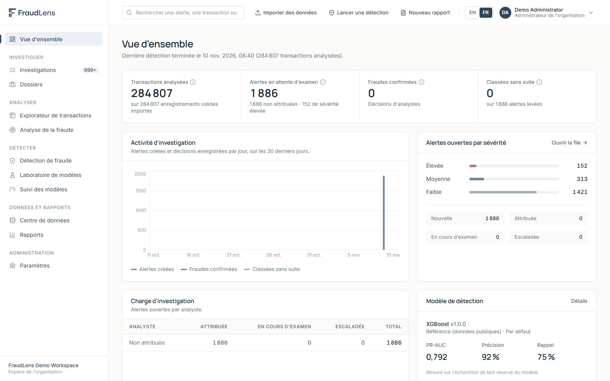 | 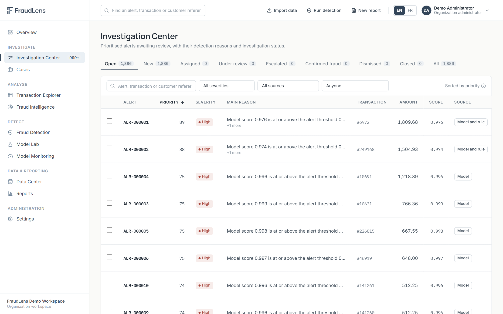 |
| Executive overview (French interface) | Prioritised alert queue |
| 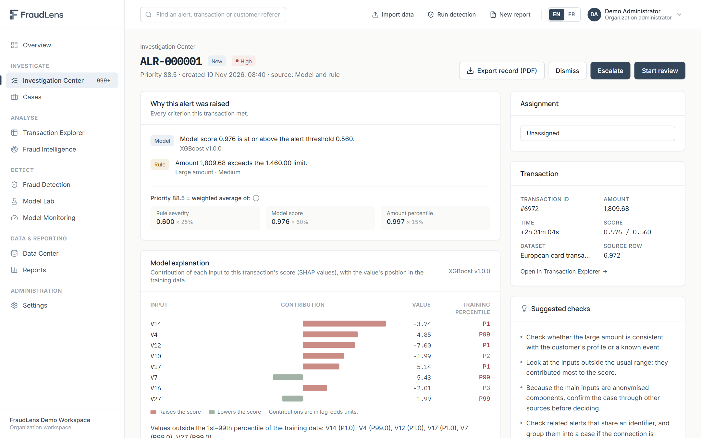 | 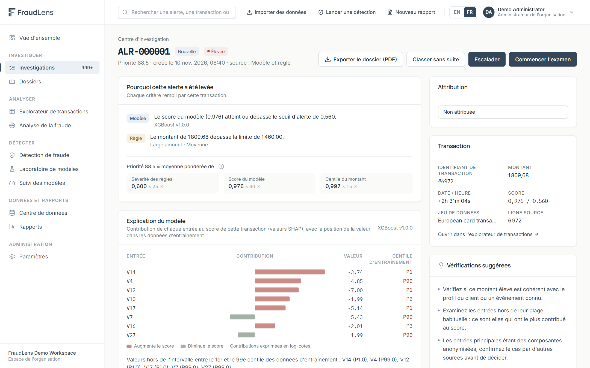 |
| Alert investigation with model explanation | The same investigation workspace in French |
| 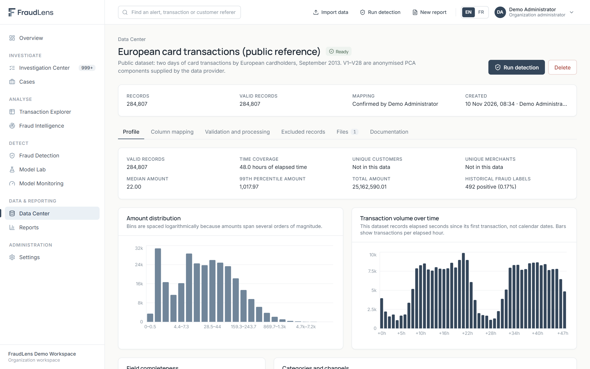 | 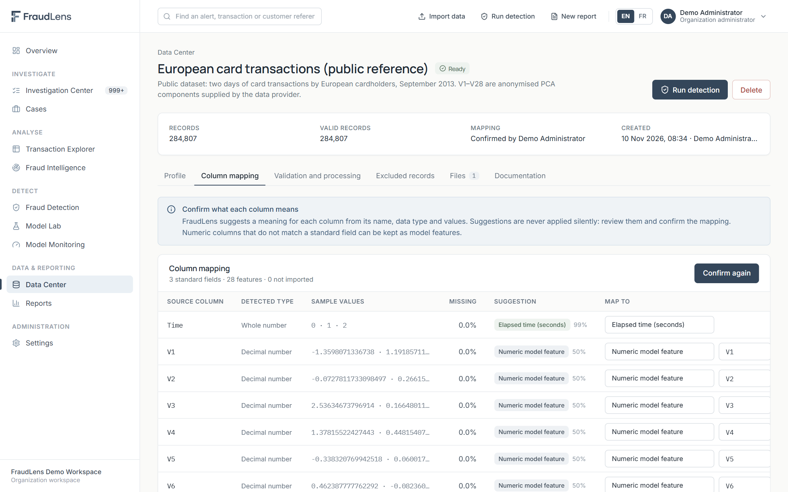 |
| Dataset profile after validation | Column mapping with stated reasons |
| 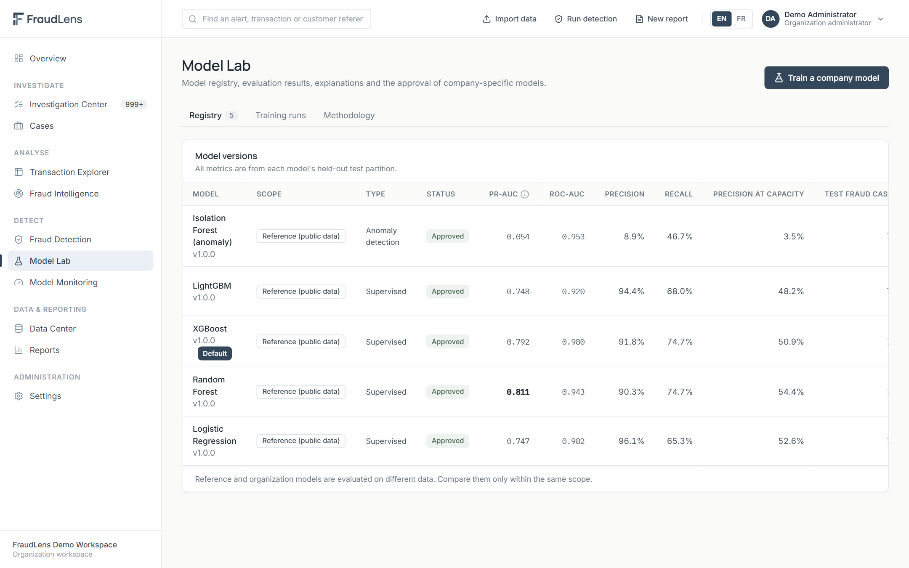 | 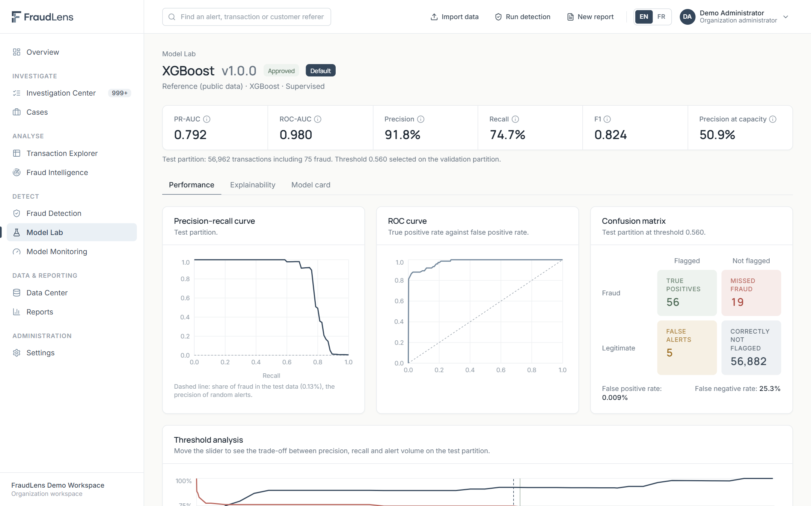 |
| Model registry | Model evaluation on the held-out test partition |
| 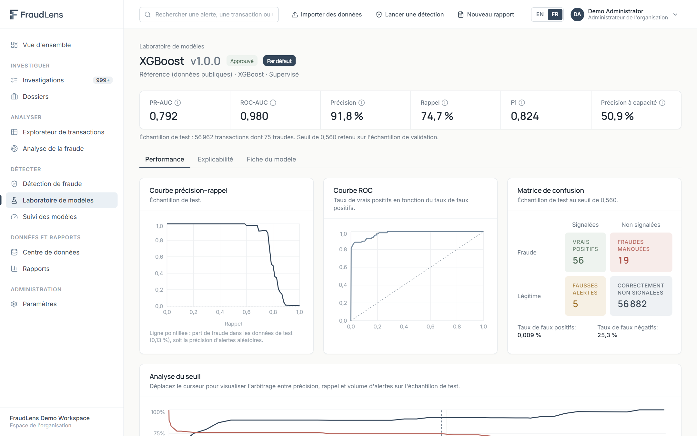 | 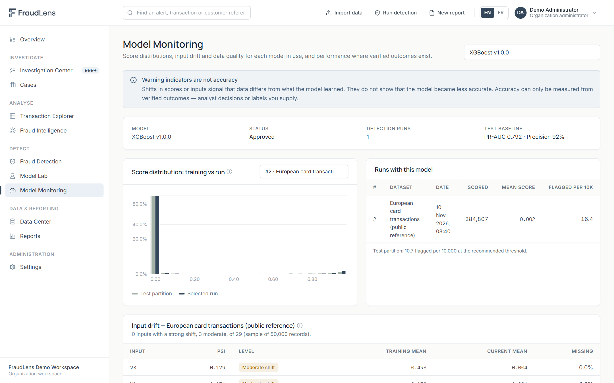 |
| Model evaluation in French | Model monitoring: score distribution and input drift |
| 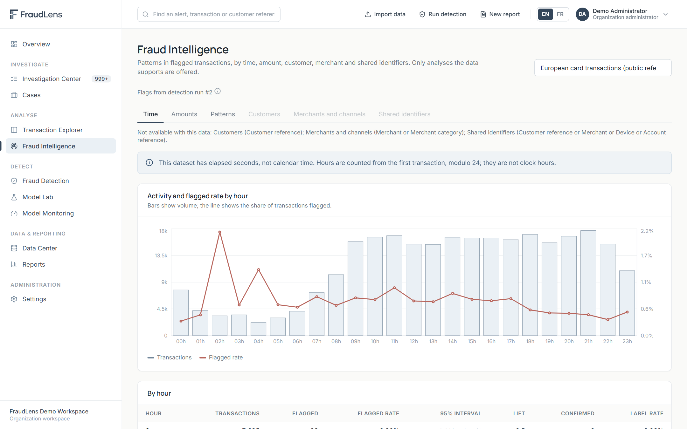 | 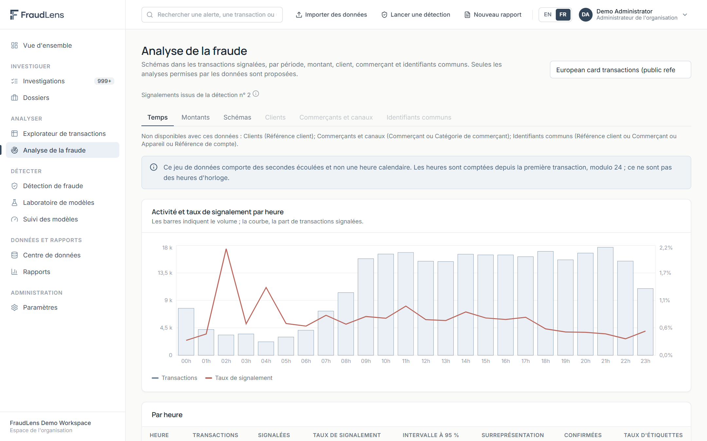 |
| Fraud intelligence by time and amount | Fraud intelligence in French |
| 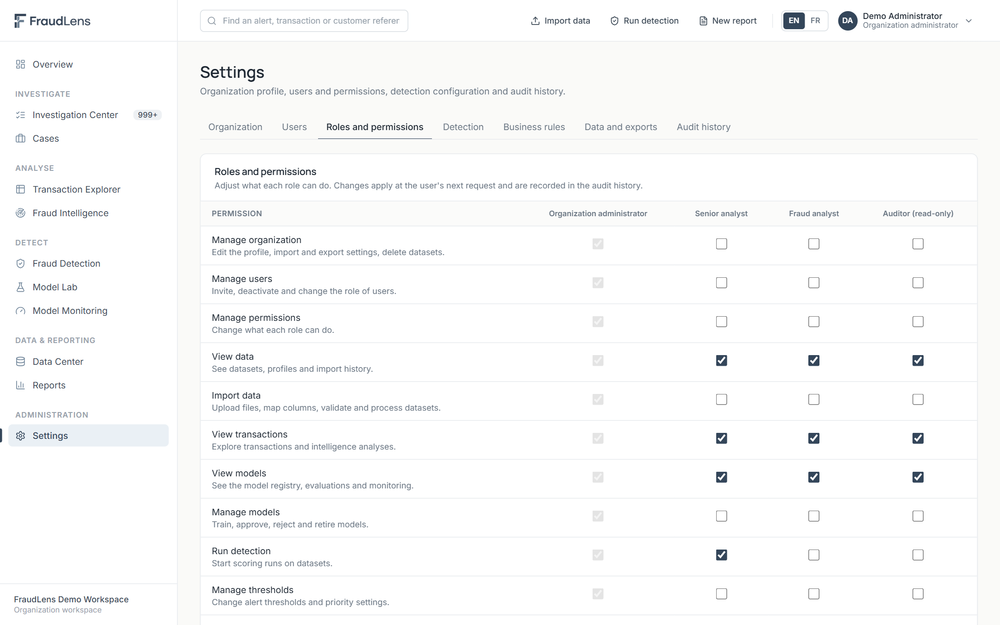 | |
| Configurable role permissions | |

## Technology

| Layer | Technologies |
|---|---|
| Frontend | React 18, TypeScript, Vite, Tailwind CSS, Radix UI, TanStack Query, i18next, Recharts |
| Backend | Python 3.13, FastAPI, Pydantic, SQLAlchemy 2, Alembic |
| Data & ML | pandas, NumPy, scikit-learn, XGBoost, LightGBM, imbalanced-learn, SHAP |
| Database | PostgreSQL 15 |
| Reporting | ReportLab (PDF), CSV |

## Architecture

A React single-page application (English and French) talks to a FastAPI backend over JSON with a session cookie. The
backend is organised by business domain — authentication and permissions, data ingestion, model registry and
compatibility, detection, investigation, intelligence, monitoring and reporting — with long operations (validation,
loading, scoring, training) running as background jobs. The organization is always derived from the authenticated
session, never from the request. More: [architecture overview](docs/architecture-overview.md).

## Database

All application data is stored in PostgreSQL, with schema changes managed through versioned migrations and no in-memory
fallback. Data is grouped into organizations and access, data ingestion, models and detection, investigation, and
governance. Every tenant-owned record carries its organization identifier, and a database trigger rejects any
modification or deletion of audit events. More: [database overview](docs/database-overview.md).

## Models and evaluation

Reference models were trained and evaluated on the public *Credit Card Fraud Detection* dataset (Worldline and ULB
Machine Learning Group, 2013; 284,807 transactions, 492 fraud) with a temporal split. Hyper-parameters, class-imbalance
treatment, calibration and the alert threshold were selected on a validation partition; the test partition was used once.

| Model (test partition: 56,962 transactions, 75 fraud) | PR-AUC | Precision | Recall |
|---|---|---|---|
| Random Forest | 0.811 | 90.3% | 74.7% |
| XGBoost | 0.792 | 91.8% | 74.7% |
| LightGBM | 0.748 | 94.4% | 68.0% |
| Logistic Regression | 0.747 | 96.1% | 65.3% |
| Isolation Forest (unsupervised, complementary signal) | 0.054 | 8.9% | 46.7% |

Precision, recall and PR-AUC are reported rather than accuracy, because fraud is about 0.17% of transactions: a model
that flags nothing would be 99.8% accurate. Organizations with sufficient labelled history can train their own
candidate models, which must be reviewed and approved before use.

## Security

Password hashing (bcrypt), login lockout, revocable server-side sessions in HttpOnly SameSite cookies, CSRF protection,
permission checks on every endpoint, tenant isolation verified by automated tests, upload restrictions, parameterised
database access, a least-privilege database role and an append-only audit history. FraudLens does not claim
certification against PCI DSS, GDPR, SOC 2 or ISO 27001.

## Limitations

- **Reference models apply only to the reference data.** They use anonymised features specific to that dataset and
  cannot score other organizations' raw data; FraudLens detects this and refuses. Their results rest on 75 test fraud
  cases, so small changes in counts move precision and recall noticeably.
- **The unsupervised model is a weak signal** (PR-AUC 0.054) and is presented only as a complement.
- **Organization isolation is enforced in the application layer**, not yet by database-level row security.
- **Not yet available:** single sign-on, multi-factor authentication, email delivery (invitation links are shown to the
  administrator), Excel and API ingestion, automatic data retention.
- **Deployment:** verified as a local installation; the container configuration has not yet been run.

The product is verified by automated backend and frontend test suites and end-to-end checks of every screen in both languages.

## Demo and source code

- **Demonstration.** The screenshots above come from a demonstration workspace built on the public reference
  dataset: four users (one per role), the dataset imported and validated, approved models and one detection run.
  No investigation decisions were recorded, so every alert shown is still "New".
- **Live walkthrough.** FraudLens is not publicly hosted. A guided demonstration of the running application can be
  arranged on request. Please get in touch through my [GitHub profile](https://github.com/Sabrine-Bejaoui).
- **Source code.** The source code, trained models, database schema and internal documentation are kept in a
  private repository and are not part of this showcase. Access for technical review can be discussed on request.

## Author and license

FraudLens was designed and developed by **Sabrine Bejaoui** ([@Sabrine-Bejaoui](https://github.com/Sabrine-Bejaoui)).

Copyright (c) 2026 Sabrine Bejaoui. All rights reserved. This repository contains documentation and images only;
no permission is granted to copy, modify or redistribute FraudLens or its materials without prior written
authorization. See [LICENSE](LICENSE).
